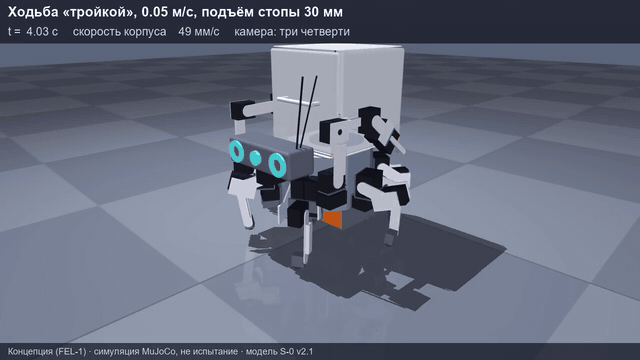

**English** · [Русский](README.ru.md)

# Avad S-0 — a learning six-legged walking robot

A six-legged robot with two arms and a swappable cargo box on its back. **S-0 is the first learning prototype**:
about 46 cm across and about 7.5 kg. It is used to test walking, carrying loads, working with the arms and
safety before building larger versions for heavy and dangerous work — in mines, on construction sites,
in frost and dust.

> **Stage: concept.** The robot has not been built or tested yet. Drawings — revision G, gripper K1 — revision D
> (preliminary): holes for servo horns and screws are assumptions until the real servos are measured.
> Before any metal is cut, a single leg is assembled on the bench first.

## Safety — no exceptions

- The robot has **no and will never have weapon functions**.
- An emergency stop button and a hardware key cut servo power **independently of the computer**
  (a relay in the power circuit; schematic — `electrical/PZ-01_schematic.pdf`).
- Lithium battery — only with a protection board; charging — supervised, in a fireproof bag.

## What's inside

Drawings and documents are in Russian (ESKD / GOST style); file names are in Latin letters.

| Folder | Contents |
|---|---|
| `docs/drawings-album-rev-G.pdf` | working drawing set: 70 sheets of parts, assemblies and diagrams (gripper K1 — revision D) |
| `docs/assembly-instruction-S0.pdf` | step-by-step assembly instruction; its wrist is the previous revision — assemble the wrist lock and gripper K1 from the sheets in `wrist-tools/assemblies/` |
| `docs/bom/` | bill of materials (119 items, Pinduoduo links, search queries in Russian, English and Chinese), fasteners and materials, manufacturing |
| `parts/` | parts: drawing (PDF, DXF), 3D model (STEP), print file (STL), sheet cutting layout (`_cut.dxf`), hole table (`_holes.csv`) |
| `assemblies/` | assembly drawings: general view, body, leg, hip joint, arm, head, cargo box |
| `purchased-parts/` | installation drawings of purchased parts: servos, Raspberry Pi 5 and Pico, cameras, power |
| `electrical/` | schematic and wiring diagrams, servo bus addresses, harnesses, electronics layout |
| `wrist-tools/` | wrist lock and swappable tools: gripper K1 (fork jaw on two servo horns, TPU pads), soldering tool, screwdriver tool |
| `sim/` | MuJoCo simulator model (model v2.6 with gripper K1) and a table of masses and inertias |
| `viewer/` | browser 3D viewer: model v2.6 of 289 parts, poses, walking, gripper, exploded view |
| `media/` | images and animations from the simulator |

**Components:** 38 servos — 18 × Feetech STS3250 and 6 × ST3215-HS on the legs, 14 × STS3215 on the arms,
head and grippers; Raspberry Pi 5, Raspberry Pi Pico, three Camera Module 3 Wide cameras; Li-ion 4S4P battery
of about 164 Wh.

## How to view

- **3D in the browser** — https://pilot443.github.io/avad-s0/viewer/ (interface in Russian): rotate with the mouse,
  change poses, open the gripper, walk with the W, A, S, D keys, explode the parts, pick a part and view it alone.
  Offline — `python viewer/serve.py`, then http://127.0.0.1:8768/ . The outer shell in the viewer is decorative;
  dimensions are those of the frame, per the drawings.
- **Drawings** — PDF in any viewer; DXF in AutoCAD, KOMPAS, LibreCAD.
- **3D models** — STEP opens in FreeCAD, Fusion 360, KOMPAS-3D.
- **Printing** — STL in any slicer (PETG; tool holders — PA-CF; foot soles — TPU 95A).
- **Simulator:** `pip install mujoco`, then `python -m mujoco.viewer --mjcf=sim/S-0-v26-k1.xml`.
  The model stands and falls without a control program; the gait program will be published later.

Animations in `media/` were recorded on the early model v2.1; drawings and `sim/` are model v2.6 with gripper K1.

## How it will be built

Purchasing goes in three waves: (1) one leg on the bench — measure the real servos and correct the drawings
before cutting metal; (2) six legs and the body, powered by a 12 V mains supply over a cable; (3) computer,
cameras, battery, arms and tools. Parts — laser-cut aluminium 1.5–7 mm, 3D printing, a little turning.

## How the project is made

The author, Ivan Kovalev (Kazakhstan), makes the decisions on the look and design and will assemble the robot.
Calculations, drawings and simulation are done to his decisions by an AI assistant based on the Claude model.
The gripper K1 layout follows the open SO-101 (TheRobotStudio) and Koch v1.1 (Apache-2.0) arms: a jaw on two
servo horns, stepped jaws, soft pads. Their files are not included in the repository; K1 parts are drawn
from scratch. The look is inspired by the walking machines of the Horizon game series; the project is not
affiliated with the game's rights holders and contains none of their materials.

## License

[CC BY-NC-SA 4.0](https://creativecommons.org/licenses/by-nc-sa/4.0/): you may copy, modify and share it
with attribution, under the same terms; **commercial use is not allowed**. Details — `LICENSE.md`.
