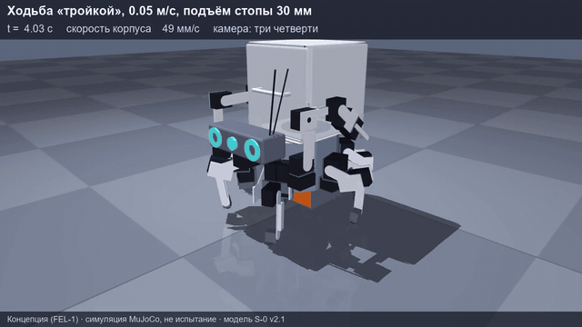

[English](README.md) · **Русский**

# Авад S-0 — учебный шагающий робот

Шестиногий робот с двумя руками и сменным контейнером на спине. **S-0 — первый учебный прототип**:
около 46 см в поперечнике и около 7,5 кг. На нём проверяются ходьба, перенос груза, работа руками
и безопасность, прежде чем делать большие версии для тяжёлой и опасной работы — в рудниках, на стройке,
в мороз и пыль.

> **Стадия: концепция.** Робот ещё не собран и не испытан. Чертежи — редакция Г, кисть-захват К1 — редакция Д (предварительные):
> отверстия под рога и винты серво — допущения до замеров настоящих приводов. Перед резкой металла
> сначала собирается одна нога на столе.

## Безопасность — без исключений

- У робота **нет и не будет боевых функций**.
- Аварийная кнопка и аппаратный ключ разрывают питание приводов **независимо от компьютера**
  (реле в цепи питания; схема — `electrical/PZ-01_schematic.pdf`).
- Литиевая батарея — только с защитой, заряд — под присмотром в огнеупорном мешке.

## Что внутри

| Папка | Что |
|---|---|
| `docs/drawings-album-rev-G.pdf` | альбом рабочих чертежей: 70 листов деталей, сборок, схем (кисть-захват К1 — редакция Д) |
| `docs/assembly-instruction-S0.pdf` | пошаговая инструкция сборки; кисть в ней — прежней редакции, замок и захват К1 собирать по листам `wrist-tools/assemblies/` |
| `docs/bom/` | ведомость закупки (119 позиций, ссылки на Pinduoduo), крепёж и материалы, изготовление |
| `parts/` | детали: чертёж (PDF, DXF), 3D-модель (STEP), файл печати (STL), раскрой листа для резки (`_cut.dxf`), таблица отверстий (`_holes.csv`) |
| `assemblies/` | сборочные чертежи: общий вид, корпус, нога, узел бедра, рука, голова, контейнер |
| `purchased-parts/` | установочные чертежи покупных: серво, Raspberry Pi 5 и Pico, камеры, питание |
| `electrical/` | принципиальная и монтажная схемы, адреса серво на шинах, жгуты, размещение электроники |
| `wrist-tools/` | замок запястья и сменные кисти: захват К1 (губка-вилка на двух рогах серво, накладки TPU), паяльная, отвёрточная |
| `sim/` | модель для симулятора MuJoCo (модель v2.6 с кистью-захватом К1) и таблица масс и инерций |
| `viewer/` | 3D-просмотр в браузере: модель v2.6 из 289 деталей, позы, ходьба, захват, разнесение деталей |
| `media/` | картинки и анимации из симулятора |

**Состав:** 38 приводов — 18 × Feetech STS3250 и 6 × ST3215-HS на ногах, 14 × STS3215 на руках, голове
и захватах; Raspberry Pi 5, Raspberry Pi Pico, три камеры Camera Module 3 Wide; батарея Li-ion 4S4P
около 164 Вт·ч.

## Как посмотреть

- **3D в браузере** — https://pilot443.github.io/avad-s0/viewer/ : вращать мышью, менять позы, раскрывать захват, идти клавишами
  W, A, S, D, разносить детали, выбрать деталь и посмотреть её отдельно. Без интернета — `python viewer/serve.py`,
  затем http://127.0.0.1:8768/ . Облицовка в просмотре декоративная, размеры — у каркаса по чертежам.
- **Чертежи** — PDF в любой программе просмотра; DXF — в AutoCAD, КОМПАС, LibreCAD.
- **3D-модели** — STEP открывается во FreeCAD, Fusion 360, КОМПАС-3D.
- **Печать** — STL в любом слайсере (PETG; держатели кистей — PA-CF; подошвы — TPU 95A).
- **Симулятор:** `pip install mujoco`, затем `python -m mujoco.viewer --mjcf=sim/S-0-v26-k1.xml`.
  Модель стоит и падает без программы управления; программа походки будет опубликована позже.

Анимации в `media/` сняты на ранней модели v2.1; чертежи и `sim/` — модель v2.6 с кистью-захватом К1.

## Как собирается

Закупка идёт тремя волнами: (1) одна нога на столе — замер настоящих серво и правка чертежей до резки
металла; (2) шесть ног и корпус на проводе от сетевого блока 12 В; (3) компьютер, камеры, батарея,
руки и кисти. Детали — лазерная резка алюминия 1,5–7 мм, 3D-печать, немного точения.

## Как сделан проект

Решения по облику и устройству принимает и собирает робота автор — Иван Ковалёв (Казахстан).
Расчёты, чертежи и симуляцию по его решениям выполняет ИИ-ассистент на модели Claude.
Схема захвата К1 — по образцу открытых рук SO-101 (TheRobotStudio) и Koch v1.1 (Apache-2.0):
губка на двух рогах серво, ступенчатые губки, мягкие накладки. Их файлы в репозиторий не входят,
детали К1 нарисованы заново. Облик — по мотивам шагающих машин из игр серии Horizon; проект с правообладателями игры не связан
и их материалов не содержит.

## Лицензия

[CC BY-NC-SA 4.0](https://creativecommons.org/licenses/by-nc-sa/4.0/): можно повторять, менять
и делиться с указанием автора на тех же условиях; **продавать нельзя**. Подробнее — `LICENSE.md`.
